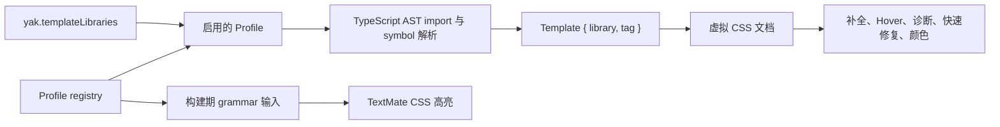

# 模板库 Profile 统一入口设计

> 状态：已实现（2026-08-25）。
>
> 本文定义并记录 `next-yak` 的当前包名、未来 `@yak/react` / `@yak/solid` 包迁移，以及兼容 `styled-components` 时的统一扩展入口。

## 决策

扩展应以**模板库 Profile**作为唯一的兼容性入口。Profile 将“模块标识符、可识别导出、内部模板语义与静态高亮信息”维护在同一处；语言功能不再各自判断 `yak`、`next-yak` 或 `styled-components`。

用户只选择要启用的已知 Profile：

```json
{
  "yak.templateLibraries": ["yak", "styled-components"]
}
```

默认值为 `['yak', 'styled-components']`。`yak` Profile 是产品的一等公民，当前首先匹配 `next-yak`；`styled-components` Profile 是复用同一套静态 CSS 语言能力的兼容层，而不是第二套 provider 或运行时集成。

## 需求与边界

- 在包名迁移期，同时识别 `next-yak`、`@yak/react` 和 `@yak/solid`。
- 让 yak 的 `styled`、`css`、`globalStyle`、`keyframes` 继续完整支持别名、命名空间和局部遮蔽检查。
- 兼容 `styled-components` 的常见 CSS tagged template 形式，并将其 API 映射至既有内部模板语义。
- 补全、hover、诊断、快速修复、颜色和插值范围映射必须共享同一份识别结果。
- 不把兼容范围扩大为“任何叫作 `styled` 的函数”。导入来源仍必须由 TypeScript AST 确认。
- 不因支持 `styled-components` 而承诺 SCSS、Sass 或 Less；虚拟文档和语言服务继续以标准 CSS 为准。

## 公共配置

已提供以下资源级设置：

```jsonc
{
  // 默认值：['yak', 'styled-components']
  "yak.templateLibraries": ["yak", "styled-components"]
}
```

设置值是 Profile ID，不是 npm 包名或 tag 名列表。它应在 `package.json` 中定义为仅允许内置 ID 的字符串数组：

```json
{
  "type": "array",
  "scope": "resource",
  "default": ["yak", "styled-components"],
  "items": {
    "type": "string",
    "enum": ["yak", "styled-components"]
  },
  "uniqueItems": true
}
```

资源级作用域允许 monorepo 中的不同工作区文件夹分别选择兼容范围。用户若同时安装官方 styled-components 扩展，可设为 `['yak']`，避免多个扩展同时在同一模板中提供语言功能。

不应先提供如下过于自由的配置：

```jsonc
{
  "yak.importModules": ["任意模块"],
  "yak.tagNames": ["styled"]
}
```

这类组合无法表达 API 差异，例如 `createGlobalStyle` 到内部 `globalStyle` 的映射，也很容易将无关库误识别为 CSS 模板。未来如有明确的第三方库需求，应增加经过设计和测试的 custom profile schema，而不是放宽当前的 AST 判定。

## 内置 Profile

| Profile ID | 模块标识符 | 外部 API | 内部模板语义 |
| --- | --- | --- | --- |
| `yak` | `next-yak`、`@yak/react`、`@yak/solid` | `styled`、`css`、`globalStyle`、`keyframes` | 同名映射 |
| `styled-components` | `styled-components` | default `styled`、具名 `styled`、`css`、`keyframes`、`createGlobalStyle` | `styled`、`css`、`keyframes`、`globalStyle` |

`createGlobalStyle` 仅是兼容层的外部 API 名称；它在扩展内部应归一化为 `globalStyle`。后续所有 CSS provider 只处理统一的 `TemplateTag`，不需要知道模板来自哪个包。

`yak` 是扩展内部 Profile ID 与设置命名空间，不是受支持的 npm module specifier。Profile 在迁移期保留 `next-yak`，并支持未来的 `@yak/react` 与 `@yak/solid`；不识别裸 `yak` import。

## Registry 结构

Profile 数据位于 [`src/templateLibraries.ts`](../src/templateLibraries.ts)，不依赖 VS Code 运行时。语义识别直接读取该 registry；构建期 grammar 生成器读取其 `staticGrammar` 数据并写入提交的 TextMate JSON，回归测试再验证生成结果。

```ts
export type TemplateLibraryId = 'yak' | 'styled-components'

export interface TemplateLibraryProfile {
  id: TemplateLibraryId
  moduleSpecifiers: readonly string[]
  defaultImport?: TemplateTag
  namedImports: Readonly<Record<string, TemplateTag>>
  namespaceImports: Readonly<Record<string, TemplateTag>>
  staticGrammar: {
    namedTagNames: readonly string[]
    styledLikeTagNames: readonly string[]
  }
}
```

具体字段可以随实现调整，但必须保持以下归属不变：

- `moduleSpecifiers`：哪些 import source 属于此 Profile。
- `defaultImport` 与 `namedImports`：如何把实际 import binding 归一化为 `TemplateTag`。
- `namespaceImports`：命名空间访问时允许作为第一个属性的导出名。
- `staticGrammar`：可静态识别的字面 tag 名；它不是导入来源真值。

语义识别产生的结果保留 Profile 身份：

```ts
interface Template {
  library: TemplateLibraryId
  tag: TemplateTag
  // 既有的正文和插值范围字段
}
```

这让未来确有差异的行为可以有明确分支，例如特定 API 的 wrapper 规则；当前 CSS provider 仍只依赖 `tag` 和安全映射，因而保持共享。

## 执行路径



`TemplateCache` 已将启用 Profile 的稳定 fingerprint 纳入缓存条件，且配置变更时会完整清空。`extension.ts` 读取资源配置后，将一个不可变的 Profile 快照传给纯函数识别层；`template.ts` 不直接读取 VS Code 配置。配置变更时会：

1. 清空模板分析缓存。
2. 重新计算已打开文档的 CSS 诊断。
3. 让后续补全、hover、代码操作和颜色请求使用新的 Profile 快照。

这既保留当前模板定位函数的可测试性，也避免同一 URI 在不同资源配置下复用错误的 AST 分析结果。

## TextMate Grammar 的边界

TextMate grammar 不能解析 import、TypeScript symbol 或运行时配置。因此它只能提供静态、尽力而为的高亮：

- grammar 的静态 tag 由构建期生成器从内置 Profile 的 `staticGrammar` 数据派生；测试在 TypeScript 与 JavaScript grammar 中验证 CSS scope，而 `yarn generate:grammars:check` 防止提交的 JSON 与 registry 漂移。
- grammar 可以识别显式 `styled`、`css`、`keyframes`、`globalStyle`、`createGlobalStyle` 等名字及其静态链式结构。
- `import sc from 'styled-components'; sc.button\`...\`` 中的任意别名 `sc` 必须由 AST provider 识别；grammar 不应假装能确认它的来源。
- 用户运行时禁用某个 Profile 后，grammar 的静态着色可能仍保留；补全、hover、诊断、代码操作和颜色必须以 AST 与设置为准。

因此，视觉高亮与语义语言功能仍然分层。Profile registry 负责让两层的内置 tag 数据可追踪，但不应让 grammar 成为识别正确性的依据。

## 兼容性规则

### Yak

下面三种 import source 应等价：

```ts
import { styled } from 'next-yak'
import { styled } from '@yak/react'
import { styled } from '@yak/solid'
```

直接、别名和命名空间导入沿用当前 yak 的严格 symbol 判定。type-only import、局部变量遮蔽和动态 tag path 一律不识别。

### styled-components

兼容范围以已知 API 的静态模板为界：

```tsx
import styled, { css, createGlobalStyle, keyframes } from 'styled-components'

const Button = styled.button`color: rebeccapurple;`
const shared = css`display: grid;`
const animation = keyframes`from { opacity: 0; }`
const GlobalStyle = createGlobalStyle`body { margin: 0; }`
```

当前兼容 default `styled`、具名 `styled`、`css`、`keyframes`、`createGlobalStyle` 及命名空间访问。每种支持的 import 形式都有 AST binding 回归测试；不要因可写出某种 TypeScript import 而默认把它视为运行时可用 API。

扩展不实现 styled-components 的运行时、主题类型、Babel/SWC 转换、SSR、transient props 或组件导航。这些不属于静态 CSS tagged-template 语言功能。

## 已实现范围

1. `src/templateLibraries.ts` 维护内置 Profile registry；`src/template.ts` 将 TypeScript AST import binding 归一化为 `Template { library, tag }`。
2. `yak` Profile 匹配当前 `next-yak`，并支持 `@yak/react` 与 `@yak/solid`；直接、别名、命名空间、type-only import、局部遮蔽和裸 `yak` import 拒绝均有测试。
3. `yak.templateLibraries` 按资源选择 Profile；变更时清空模板缓存并刷新已打开文档的 CSS 诊断。
4. `styled-components` Profile 支持 default/具名/命名空间的 `styled`、`css`、`keyframes` 与 `createGlobalStyle`，后者归一化为 `globalStyle`。
5. TypeScript、TSX、JavaScript 和 JSX 的 grammar 静态支持 `createGlobalStyle`；语义 provider 仍以 AST 与资源设置为真值。
6. Extension Host 测试验证 `next-yak` 和 styled-components 的补全；styled-components 模板还覆盖 hover、诊断、快速修复和颜色 provider。

## 验收条件

- 三个 yak Profile 模块标识符对同一合法模板产生相同的 AST 识别、CSS 语言功能和安全 range 映射结果。
- 禁用 `styled-components` Profile 后，其模板不产生本扩展的语义补全、hover、诊断、快速修复或颜色结果。
- `styled-components` 的合法导入不会误把同名局部变量或其他模块的 `styled` 识别为 CSS 模板。
- `createGlobalStyle` 与 yak `globalStyle` 使用同一套全局 CSS wrapper、诊断和 range 安全规则。
- 配置改变后，已打开文档不会继续使用旧 Profile 的缓存结果。
- grammar 与语义 provider 的差异有回归测试，并在文档中保持显式说明。

## 结论

以 Profile ID 为用户入口，以 registry 为实现入口，以 `Template { library, tag }` 为 provider 入口，可以把包名迁移、yak 一等支持和 styled-components 兼容收敛到一个可测试的边界。新增库或新的 yak 包名时，只需扩展对应 Profile、测试矩阵与静态 grammar 输入，而不需要在补全、hover、诊断、快速修复和颜色代码中复制判断分支。
